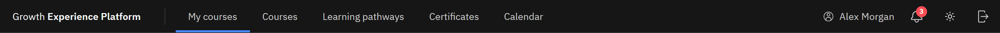

# Find your way around

The dark header bar sits across the top of every page in GXP.

1. The main links

   Click **Growth Experience Platform** (far left) to return to **My courses**, your home page. Next to it are
   **My courses**, **Courses**, **Learning pathways**, **Certificates** and **Calendar**. If your role includes managing
   or reporting on learning, you'll also see **Manage**.

   

2. The icons on the right

   Your name comes first, then the **Notifications** bell, the **Change theme** icon (a sun or a moon) and **Sign out**.

3. On a smaller screen

   When the window is narrow, the links move into a menu. Click the menu icon at the left of the header to open it.

4. Inside a course

   While a course is open, the header shows only the course title and a **Close course** button. Close the course to
   get the links back. Your progress is saved when you close it.
