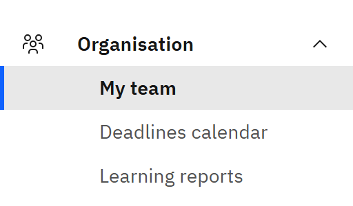

# What you see depends on your role

Every page about your own learning is the same for everyone. Extra areas appear only if your role needs them.

1. Everyone is a learner

   As soon as you sign in, you're a **Learner**. You can see **My courses**, **Courses**, **Learning pathways**,
   **Certificates**, **Calendar** and your notifications. You see only your own learning.

2. Managers and administrators also see Manage

   **Manage** appears in the header when you have another role as well:

   - **Line manager** is given automatically when someone reports to you. It shows your team's learning.
   - **Learning manager** and **Report viewer** cover the people in particular schools or units.
   - **Course manager**, **HR manager** and **Organisation administrator** cover the whole organisation.

   Inside **Manage**, the side menu lists only the areas your role can use.

   

3. If something is missing

   If you expect to see **Manage**, or an area inside it, ask your organisation administrator to check your access. A
   line manager's access follows the reporting lines from HR, so a change of manager appears after the next HR sync.
   For what each role can do, see [Understand the roles](../12-Access-and-permissions/01-understand-the-roles.md).
