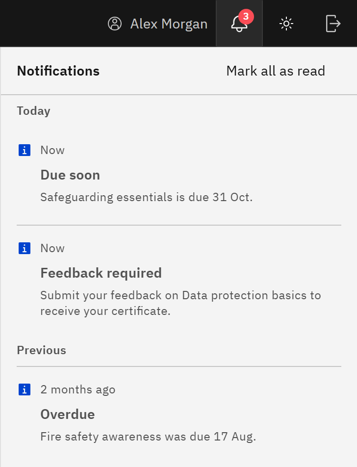

# Check your notifications

The bell in the header gathers the things you need to act on in your learning.

1. Open the bell

   Click the **Notifications** bell. A red number on it shows how many items you haven't read yet (it reads **9+** above
   nine). The **Notifications** panel opens, with items under **Today** and **Previous**.

   

2. Read the items

   - **Overdue**: mandatory learning you haven't finished was due on the date shown. Recommended learning is never
     overdue.
   - **Due soon**: a course is due within the next seven days.
   - **Feedback required**: submit feedback on a course you've finished to receive its certificate.
   - **Feedback needed**: share your feedback on a course you've finished.

   The most pressing items come first.

3. Act on an item

   Click an item. It's marked as read and takes you to the thing it's about: the course's details for due dates, or the
   **Course feedback** form for feedback.

4. Clear the count

   Click **Mark all as read**. When there's nothing left, the panel says **You are all caught up**.

Notifications are worked out from your courses each time GXP loads, and what you've read is remembered in this browser
only. On another computer or browser, items you've already read show as unread again. Emails are separate; see
[Emails you receive about your learning](./06-understand-learning-emails.md).
