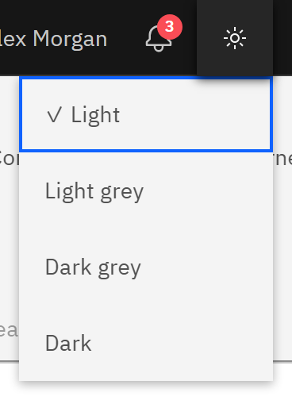

# Change the theme

Switch GrowthXP between light and dark to suit your screen and surroundings.

1. Open the theme menu

   Click the **Change theme** icon in the header, next to the bell. It shows a sun in the light themes and a moon in the
   dark ones.

2. Choose a theme

   Choose **Light**, **Light grey**, **Dark grey** or **Dark**. A tick marks the one you're using.

   

The theme changes straight away and is remembered in this browser, so set it again on another computer. The header bar
stays dark in every theme.
