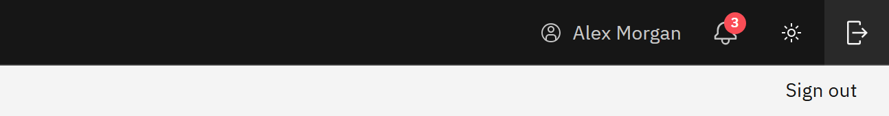

# Sign out

1. Close any open course

   If you're in a course, click **Close course** first. Your progress is saved when the course closes.

2. Click Sign out

   Click **Sign out**, the icon at the far right of the header. GrowthXP signs you out through Microsoft and returns to the
   sign-in page.

   

On a shared computer, also close the browser when you've finished.
