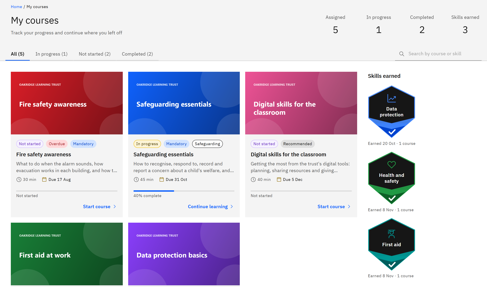

# View your courses

**My courses** is your home page in GXP. It lists every course assigned to you, and every course you've opened from
the catalogue, with your progress.

1. Open My courses

   Click **My courses** in the header. Along the top, the learning summary counts your **Assigned**, **In progress** and
   **Completed** courses and your **Skills earned**.

   

2. Filter by status

   Click a tab to narrow the list: **All**, **In progress**, **Not started** or **Completed**. Each tab shows how many
   courses it holds.

3. Search

   Type in the search box (**Search by course or skill**) to find a course by its title or by a skill it teaches. Click
   **Clear search** if nothing matches.

4. Work from the top

   Courses are ordered for you: overdue mandatory learning first, then courses with a due date (soonest first), then
   courses in progress, then ones you haven't started. Completed courses go to the end.

5. Open a course

   Click a card to open the course's details, where you can launch it. The words at the bottom of the card tell you what
   happens next: **Start course**, **Continue learning**, **Review course** or **Submit feedback**.

A course you open from **Courses** appears here even if nobody assigned it to you. Courses given to a group you belong to
appear here too.
