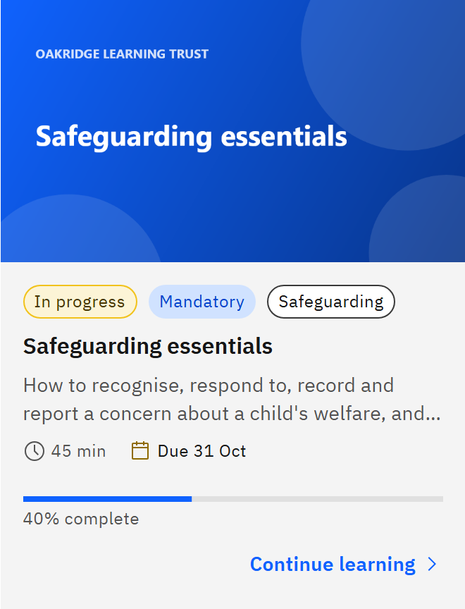

# Read a course card

Each card in **My courses** sums up where you are with one course.

1. Status and type tags

   The first tag is the status: **Not started**, **In progress** or **Completed**. Other tags can follow:

   - **Mandatory** or **Recommended**: how the learning was given to you (hidden once completed).
   - **Renewal 1**, **Renewal 2** and so on: you're on a renewal of learning you completed before.
   - **Self-enrolled**: you enrolled in it yourself.
   - **Recorded in HR**: completed outside GXP and recorded in your HR system.
   - **Feedback required**, **Feedback overdue** or **Feedback needed**: you owe feedback on the course.
   - Up to three skills the course teaches.

   

2. The details line

   Under the title and description you'll see the course's length, and whichever of these apply:

   - **Due** and a date, until you've completed it.
   - The date you completed it.
   - How long the completion stays valid: **Valid until**, **Expires** (expiring soon), **Expired** or **No expiry**.
   - When feedback is due, or since when it's been overdue.

3. Progress

   The bar shows how much of the course you've done: a percentage, **Not started**, or **Opened, no progress yet** if
   you opened it without getting further. A completed course always shows 100%.

4. What clicking does

   The last line says what happens when you click the card: **Start course**, **Continue learning**, **Review course**,
   **Submit feedback**, or **Not available** if the course can't be opened at the moment.

5. Buttons under the card

   **Training history** appears once you've completed the course or have earlier cycles of it. **Withdraw** appears on a
   course you enrolled in yourself and haven't started.
