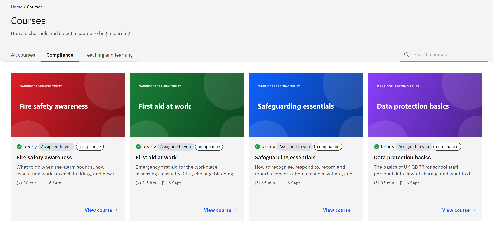

# Browse the course catalogue

**Courses** lists every course your organisation offers you, grouped into channels.

1. Open Courses

   Click **Courses** in the header.

2. Choose a channel

   Click a channel tab, such as **Compliance**, to see only its courses, or **All courses** to see everything.

   

3. Search

   Type in **Search courses** to find courses by title, description or tag. Click **Clear search** if nothing matches.

4. Check the card

   Each card shows the course's length and when it was added, and where you stand with it: **Assigned to you** means
   it's been given to you, **Self-enrolled** means you enrolled in it yourself, and **Open to enrol** means you can enrol
   in it yourself.

5. Open the course

   Click a card (**View course**) to open its details, where you can enrol or launch it.

You only see published courses offered to you, which can depend on your school or organisation. Some courses appear
only once they've been assigned to you.
