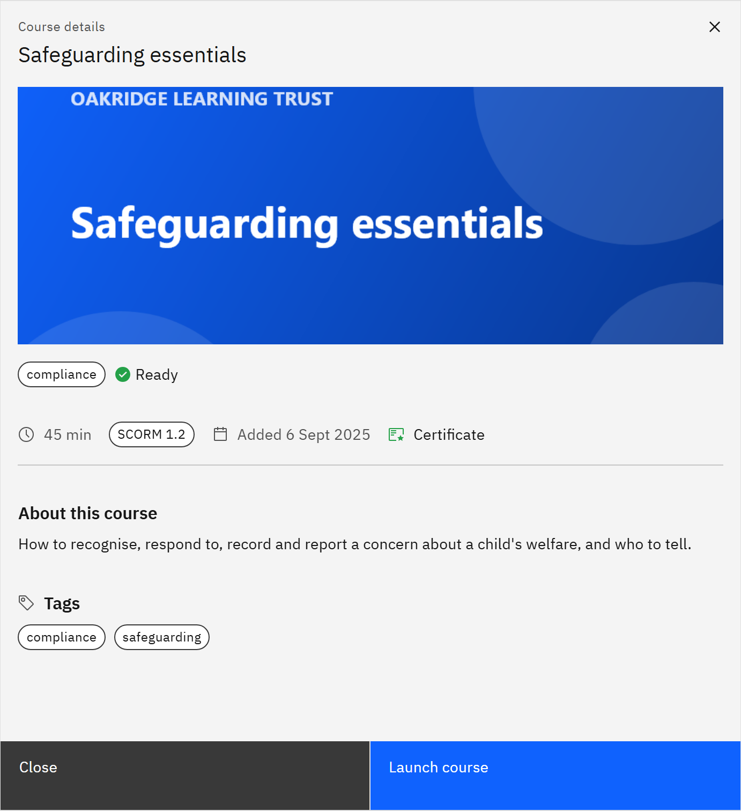

# View course details

The details dialog tells you what a course is about and is where you launch it.

1. Open the details

   Click a course card in **My courses** or **Courses**. You can also get here from a notification, from **Open course**
   in your calendar, or from a course in a learning pathway.

2. Read about the course

   Under the title you'll see its length, its SCORM version, when it was added and **Certificate** if it awards one.
   Then **About this course**, its **Tags**, **Skills you’ll develop** and any **Materials** to download.

   

3. Check the messages

   - **Certificate**: completing the course earns you a certificate.
   - **Expires** or **Expired**: the date the course itself stops being available. After it, nobody can launch it.
   - **Not yet available**: the course is still being prepared.

4. Choose what to do

   Click **Launch course** to start or continue. **Enrol** appears if you can add the course to your courses yourself.
   If the button reads **Course expired** or **Not available yet**, the course can't be opened at the moment. Click
   **Close** to go back.
