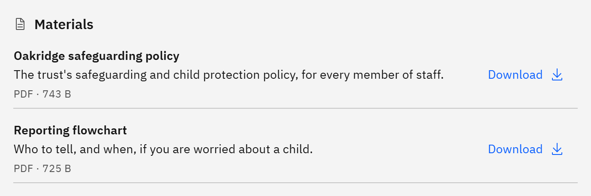

# Download course materials

Some courses come with materials, such as handouts or slides, that you can keep.

1. Open the course details

   Click the course card in **My courses** or **Courses**.

2. Find Materials

   Scroll to **Materials**. Each file shows its name, a description, and its type and size.

   

3. Download

   Click **Download** next to the file. It saves to your device with its original name.

If there's no **Materials** section, the course has no files for you. New files appear only once they've passed a
security check. If you see **Materials unavailable**, close the course details and open them again.
