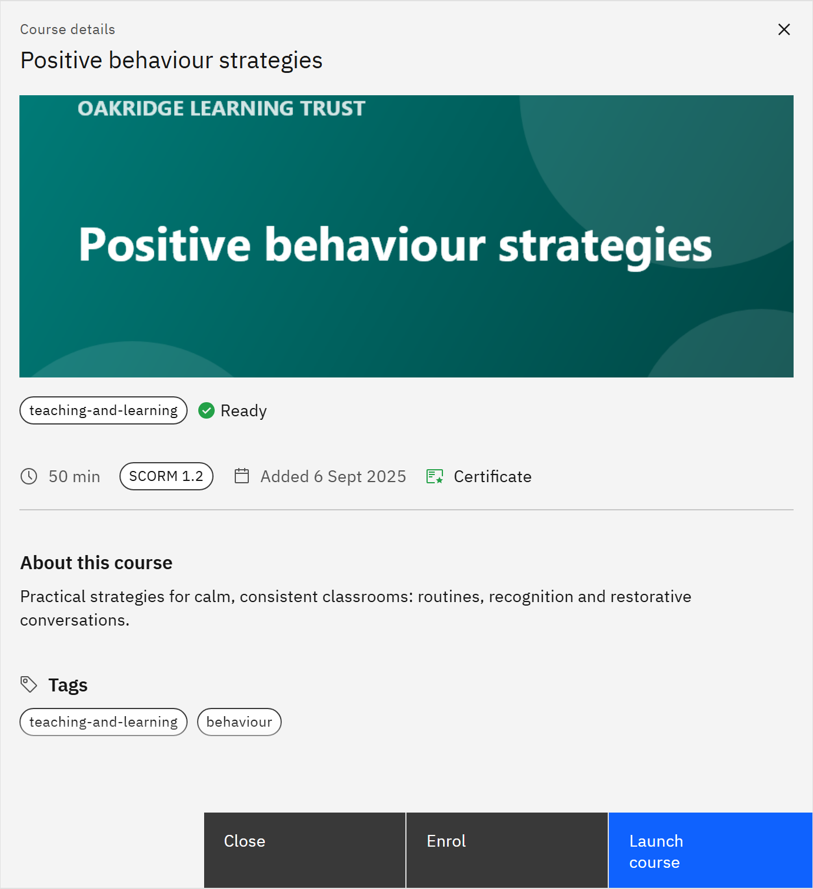

# Enrol in a course

Some courses let you enrol yourself, without waiting for someone to assign them.

1. Find a course you can enrol in

   In **Courses**, look for the **Open to enrol** tag on a card, then click the card.

2. Click Enrol

   In the course details, click **Enrol**. A message confirms **Enrolled**.

   

3. Find it in My courses

   The course now appears in **My courses** with the **Self-enrolled** and **Recommended** tags. Launch it whenever
   you're ready.

Learning you enrol in yourself is **Recommended**: it has no due date unless your organisation sets one for recommended
learning, and it's never overdue. If there's no **Enrol** button, the course doesn't allow self-enrolment or you already
have it; you can still launch a course you can see, or ask your administrator to assign it. You can withdraw until you
start the course.
