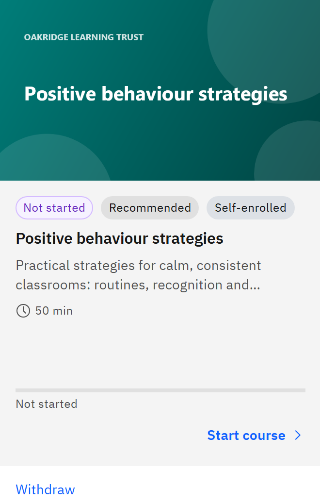

# Withdraw from a course you enrolled in

If you enrolled in a course yourself and haven't started it, you can take it out of your courses.

1. Find the course

   In **My courses**, find the card with the **Self-enrolled** tag.

2. Click Withdraw

   Click **Withdraw** under the card.

   

3. Confirm

   In **Withdraw enrolment?**, click **Withdraw enrolment**, or **Keep enrolment** to change your mind. A message
   confirms **Enrolment withdrawn**.

The course stays in **Courses**, so you can enrol again later. **Withdraw** disappears as soon as you open the course,
and it never appears on learning that was assigned to you; ask whoever assigned that learning if you think you
shouldn't have it.
