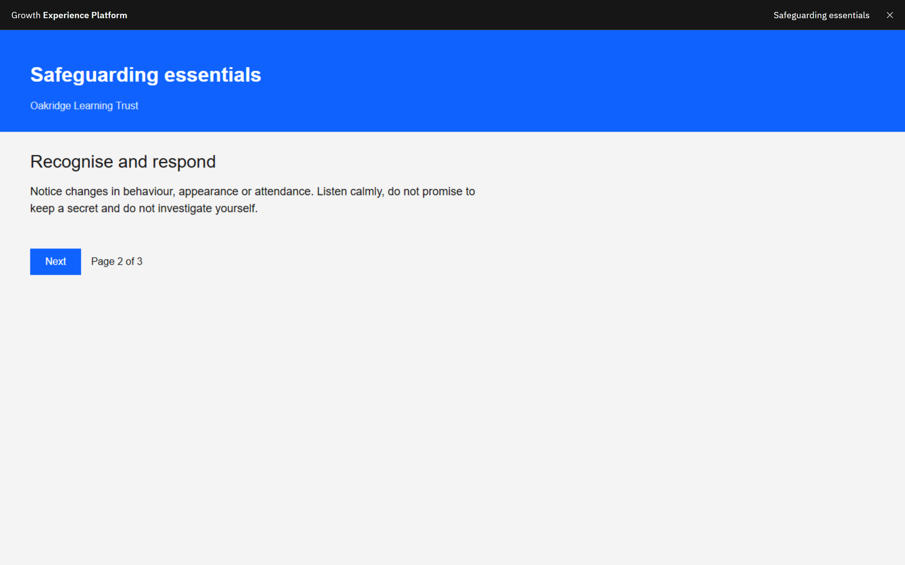

# Start or resume a course

Courses play inside GXP and save your progress for you.

1. Launch the course

   Click the course card in **My courses** (it says **Start course** or **Continue learning**), then click **Launch
   course** in the course details.

2. Work through the course

   The course fills the page. The header shows the course title and a **Close course** button. Your answers and your
   place are saved automatically every few seconds.

   

3. Close the course

   Click **Close course** when you want to stop. Your progress is saved and you return to the course details. Progress
   is also saved if you switch tab or close the browser.

4. Continue later

   Open the course again and click **Launch course**. Your saved progress is restored, so most courses take you back to
   where you left off or offer to.

If you lose your connection, GXP keeps your latest progress in this browser and sends it the next time you open the
course here. If you see **Course could not be opened**, check your connection and try again. If the course says its link
has expired, close it and launch it again.
