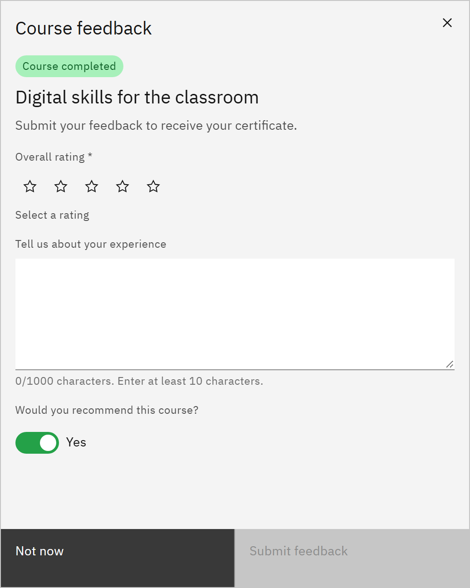

# Complete a course

A course is complete when the course itself says you've finished or passed it. There's no button to mark it complete.

1. Finish the course content

   Work through to the end of the course, including any quiz it ends with. When the course reports **completed** or
   **passed**, or you reach its final page, GrowthXP records your completion.

2. Give feedback

   The **Course feedback** form opens. Fill it in now, or click **Not now** and come back later. See
   [Give feedback on a course](./12-give-feedback-on-a-course.md).

   

3. See it completed

   In **My courses** the card shows **Completed**, 100% and the date you finished. If the course awards a certificate,
   it appears in **Certificates**, unless the course waits for your feedback first.

4. Check how long it stays valid

   Some learning is valid for a set time, such as 12 months. The card shows **Valid until** and the date, or **No
   expiry**. See [Check when your learning expires](./13-check-when-your-learning-expires.md).

Your completion date is recorded once and never changes. Click **Review course** to go back through a completed course;
reviewing it doesn't change your completion. If a course you've finished still shows **In progress**, launch it again
and make sure you reach its last page or result screen.
