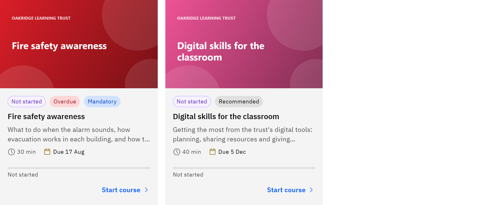

# Mandatory and recommended learning

Each course you're given is tagged **Mandatory** or **Recommended** on its card in **My courses**.

1. Mandatory learning

   You need to complete it by its due date. You're reminded before the date, it becomes overdue if you miss it, and it
   counts towards your organisation's compliance reports. If it has a validity period, it's given to you again before it
   expires.

   

2. Recommended learning

   It's suggested for you but optional. It may have a due date to help you plan, but it's never overdue, you never get
   overdue notices for it, and it isn't renewed. Courses you enrol in yourself are always recommended.

3. It depends on who it's for

   Mandatory or recommended is decided when the learning is given to you, not by the course. The same course can be
   mandatory for one group of staff and recommended for another.

4. When it comes from more than one place

   If a course reaches you in more than one way, for example from a rule for all teachers and from your manager, you see
   one card. It's **Mandatory** if any of them makes it mandatory, and it's due on the earliest mandatory due date.

The tag disappears once you've completed the course. Learning given to you before this classification existed has no tag
and is treated as mandatory.
