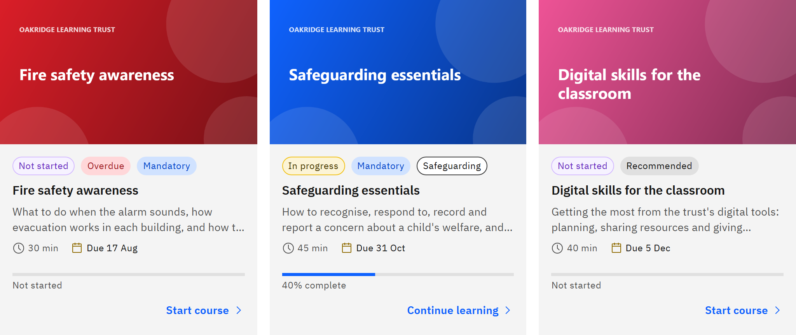

# Check due dates and overdue learning

1. See what's due

   In **My courses**, each card you haven't completed shows **Due** and the date. Cards with due dates come first,
   soonest first.

   

2. Spot overdue learning

   Mandatory learning that's past its due date moves to the top of **My courses**. It shows as **Overdue** in the
   **Notifications** bell and on your **Calendar**. Learning due in the next seven days shows as **Due soon** in the bell.

3. Know where the date came from

   Whoever gave you the learning set the date. Learning from your organisation's rules is usually due a set number of
   days, such as 30, after you join or after the rule starts. A due date runs to the end of that day.

4. Catch up

   Open the course and complete it. It stops being overdue as soon as it's completed.

You'll get reminder emails before the date and overdue notices afterwards, if your organisation has them switched on.
Recommended learning is never overdue. You can't change a due date yourself; if you need more time, ask your line
manager or HR. If your organisation has turned on manager escalation, your line manager is told when mandatory learning
stays overdue after several reminders.
