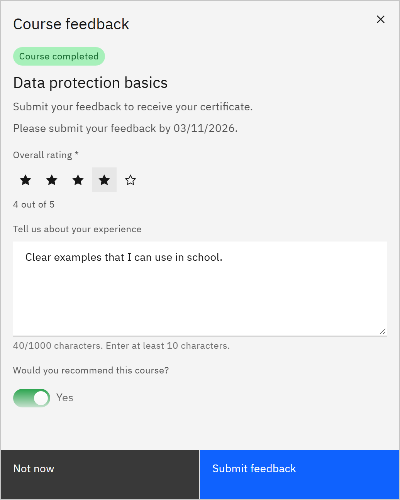

# Give feedback on a course

You're asked for feedback on every course you complete. For some courses, it's required before you receive the
certificate.

1. Open the feedback form

   The **Course feedback** form opens when you complete a course. To come back to it later, click **Give feedback** under
   the course card in **My courses**, click the **Feedback required** or **Feedback needed** item in the bell, or use the
   link in a feedback reminder email. Clicking the card itself opens the course, so you can review it first.

2. Rate the course

   Under **Overall rating**, click one to five stars.

   

3. Describe your experience

   In **Tell us about your experience**, write between 10 and 1,000 characters.

4. Say whether you'd recommend it

   Set **Would you recommend this course?** to **Yes** or **No**. It starts on **Yes**.

5. Submit

   Click **Submit feedback**. It becomes available once you've chosen a rating and written at least 10 characters. A
   message confirms **Feedback submitted**, and says when your certificate is now available.

Click **Not now** to leave the form for later; the card keeps a feedback tag and **Give feedback** until you submit. The form tells you if
your feedback is required for the certificate and when it's due. Feedback after the due date is still accepted and is
marked as late. Each renewal of a course asks for feedback again.
