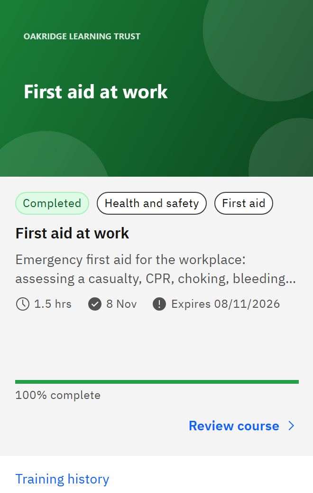

# Check when your learning expires

Some learning, such as first aid or safeguarding, is only valid for a set time after you complete it.

1. Look at the completed card

   In **My courses**, click the **Completed** tab. Each card shows its validity next to the completion date:

   - **Valid until** and a date: your completion is current.
   - **Expires** and a date: it expires soon.
   - **Expired** and a date: it has expired.
   - **No expiry**: it never needs renewing.

   

2. See expiry dates in your calendar

   **Calendar** shows each **Expiry**, and for mandatory learning the date its **Renewal due** starts.

3. Know how it's worked out

   The validity runs for whole calendar months from the moment you completed the course, for example 12 months. A
   completion on 29 February expires on 28 February. The length is set by the course or by your organisation, and it's
   fixed when you complete: later changes to the setting don't move your expiry date.

Expired learning still shows as **Completed**; only its validity changes. Mandatory learning is usually assigned to you
again before it expires. See [Renew your learning](./14-renew-your-learning.md). Dates are the same for everyone,
whatever your time zone.
