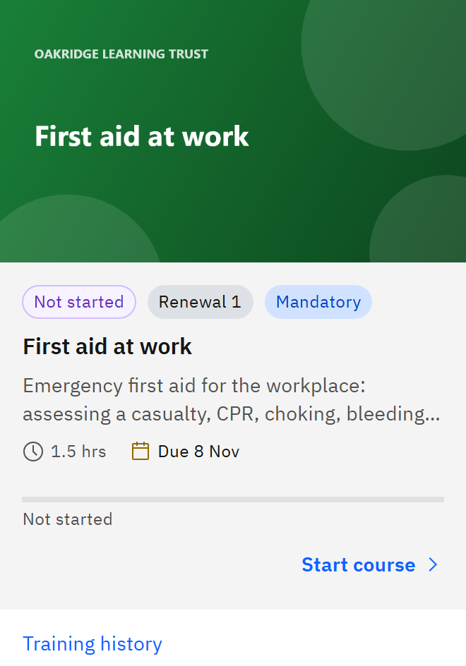

# Renew your learning

When mandatory learning is close to expiring, GrowthXP gives it to you again so you can renew it before it lapses.

1. Notice the renewal

   You may get a **Renewal due** email, and the course returns to the top of **My courses** with a **Renewal 1** tag (then
   **Renewal 2**, and so on), the status **Not started** and a due date. The due date is usually the day your current
   completion expires.

   

2. Complete the course again

   Launch the course and work through it as usual. Your earlier progress doesn't count towards the renewal, so you start
   from the beginning.

3. Check your new validity

   When you complete it, a new validity period starts from the new completion date. If the course awards a certificate,
   you get a new one for this renewal.

Renewals are for mandatory learning only. They're usually created 30 days before expiry, but this depends on your
organisation's settings and on when it runs its renewal check. Your earlier completions and certificates stay on record:
see [View your training history](./15-view-your-training-history.md). If your organisation renews your learning early, the
history shows **(early)** next to that renewal.
