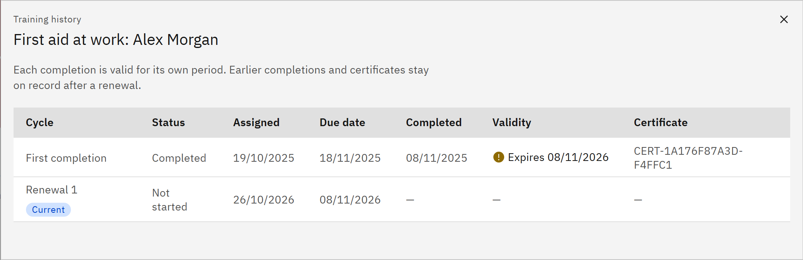

# View your training history

Training history shows every time you've been given and completed a course, including renewals.

1. Open the history

   In **My courses**, click **Training history** under the course's card. It appears once you've completed the course or
   have earlier cycles of it.

2. Read each cycle

   Each row is one cycle: **First completion**, **Renewal 1**, **Renewal 2** and so on. **Current** marks the cycle
   you're on now. The columns show the **Status**, when it was **Assigned**, its **Due date**, when it was
   **Completed**, its **Validity** and the **Certificate** number.

   

3. Close it

   Click the close button (X) to return to **My courses**.

Each completion is valid for its own period. Earlier completions and certificates stay on record after a renewal; you can
find their certificates in **Certificates**.
