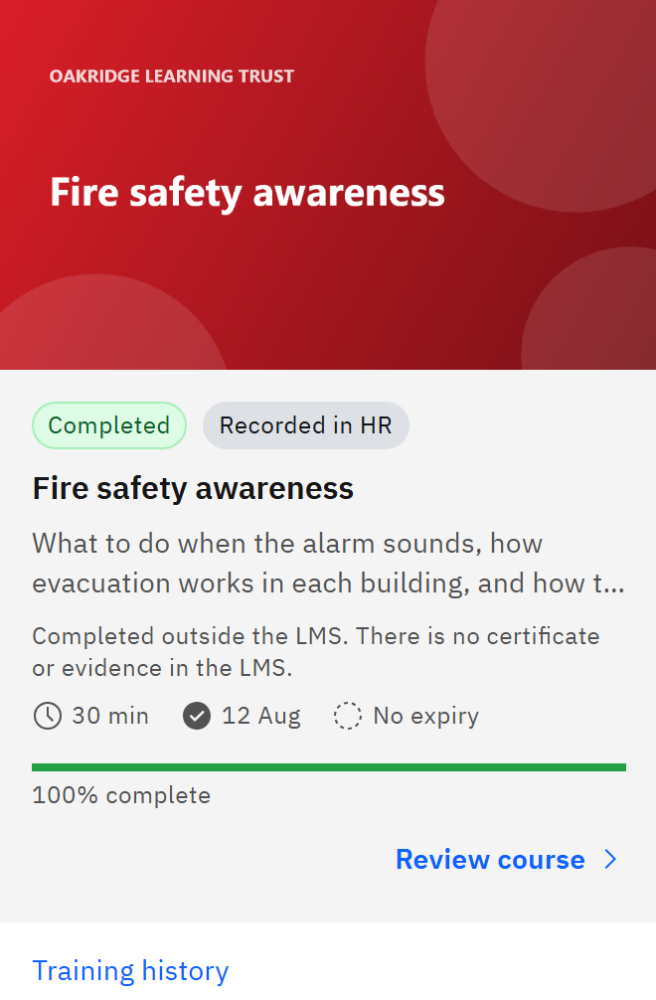

# Learning recorded in HR

If your organisation connects GrowthXP to its HR system, courses you completed outside GrowthXP can be brought in as completed.

1. Recognise the tag

   The card in **My courses** shows **Completed** and **Recorded in HR**, with the note "Completed outside the LMS. There
   is no certificate or evidence in the LMS."

   

2. Know what it counts for

   The course counts as completed for your organisation's compliance. Its validity and any renewal are worked out from
   the completion date in HR.

3. Know what you don't get

   GrowthXP has no certificate for it, doesn't ask for your feedback and doesn't send a completion email.

4. Complete it in GrowthXP if you need to

   If you need a certificate or the course material, launch and complete the course in GrowthXP. Your GrowthXP completion then
   replaces the HR record, and feedback and any certificate follow as usual.

This only happens if your organisation has switched on importing completions from HR.
