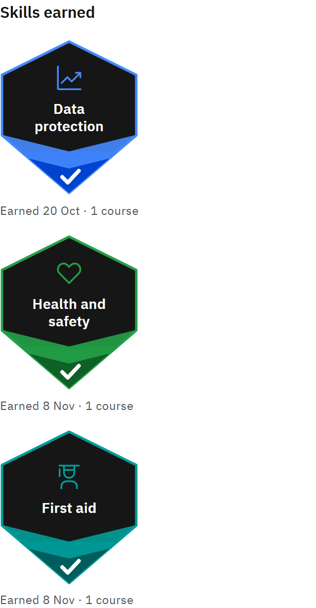

# See the skills you've earned

Courses can teach skills. When you complete a course, you earn its skills.

1. Check the count

   In **My courses**, the learning summary shows how many **Skills earned** you have.

2. Look at your badges

   The **Skills earned** shelf, beside your courses or below them on a smaller screen, shows a badge for each skill. Each
   one says when you earned it and from how many courses.

   

3. Find courses by skill

   Type a skill's name in the **My courses** search box to see the courses that teach it. In course details, **Skills
   you’ll develop** lists a course's skills before you start.

A skill counts once, however many courses teach it. The earliest completion is the date you earned it.
