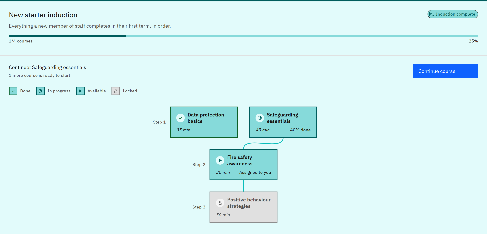
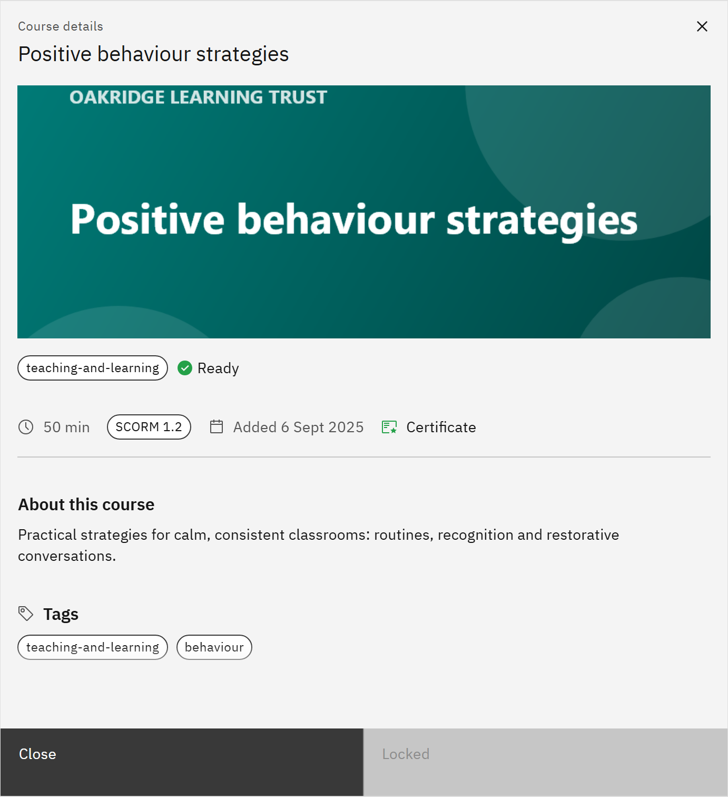

# Follow a learning pathway

A learning pathway sets courses in an order, in steps, leading to a certification such as an induction programme.

1. Open Learning pathways

   Click **Learning pathways** in the header. Each pathway has a card with its title, its certification and a short
   description. The footer shows your progress and the course to do next. If none have been published for you, the page
   says **No pathways yet**.

2. Open a pathway

   Click the pathway's card. It opens to show the steps, and moves to the top of the page. Click it again to close it.

   

3. Pick the next course

   **Next up** (or **Continue**, for a course you've started) names the course to do now. Click **Start course** or
   **Continue course** to open its details. If more courses are ready, the card says how many.

4. Or choose from the steps

   The steps run from **Step 1** downwards, and lines link each course to the ones it builds on. Each course is marked
   **Done**, **In progress**, **Available** or **Locked**. Click any course to open its details.

5. Launch the course

   In the course details, click **Launch course**. Work through it as usual; your progress also shows in **My courses**.

6. Check a locked course

   A **Locked** course still opens its details, so you can read what's coming. The details say **Locked in this
   pathway** and name the courses to finish first, and the button reads **Locked** instead of **Launch course**. Finish
   those courses and it becomes **Available**.

   

Learning that's assigned to you, or that you've already started, is never locked by a pathway; a course that's open for
that reason says **Assigned to you**. When you've completed every course in the pathway, and given any feedback that's
required, you receive the pathway's certificate automatically if it has one. It appears in **Certificates**. If the page
says **Pathways not loaded**, click **Try again**.
