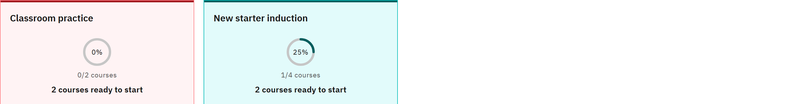

# Track your pathway progress

{/* PO REVIEW: see gxp-help-reference/features/learning-pathways.md, open questions 1 and 2. In the current build the
Done marks and the percentage are not worked out from the learner's completions, and Locked is not enforced. This page
describes the intended behaviour and must be confirmed or rewritten before publishing. */}

1. Check the card

   On **Learning pathways**, each closed card shows a ring with a percentage, the number of courses done out of the
   total (for example **2/6 courses**) and a short line such as **Next:** and a course, or **Pathway complete**.

   

2. Read the marks in the steps

   Open the pathway. The key explains the mark on each course:

   - **Done**: you've completed it.
   - **Available**: you can take it now, because the courses before it are done or it has none.
   - **Locked**: it builds on a course you haven't completed yet.

3. See progress in a course

   A course you've started shows how far through it you are, for example **40% done**.

Your progress on each course is the same as in **My courses**, so check there for due dates and completion dates.
