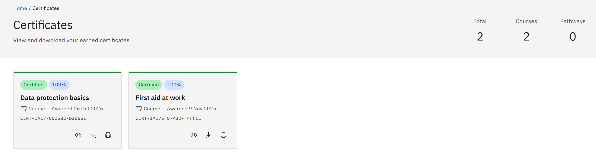

# View your certificates

1. Open Certificates

   Click **Certificates** in the header. Along the top you'll see how many certificates you have in **Total**, and how
   many are for **Courses** and **Pathways**.

2. Read a certificate card

   Certificates are listed newest first. Each card shows **Certified**, your grade if one was recorded, the course or
   pathway name, whether it's a **Course** or **Learning pathway** certificate, the date it was **Awarded** and its
   certificate number.

   

3. Choose what to do

   Click the title or **Open certificate page** to see the certificate. Click **Download** to save it, or **Print** to
   print it.

If you see **No certificates yet**, you haven't completed a course or pathway that awards one, or the certificate is
waiting for your feedback. When you renew a course you get a new certificate, and the earlier ones stay here.
