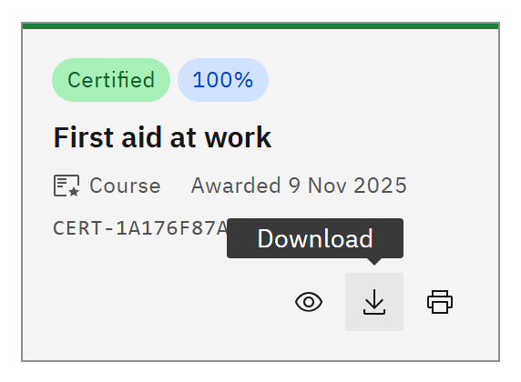

# Download a certificate

1. Find the certificate

   Click **Certificates** in the header and find the card.

2. Click Download

   Click **Download** (the arrow icon) on the card. You can also open the certificate page and click **Download** at the
   top; it reads **Preparing…** for a moment.

   

3. Find the file

   Your browser saves an image file named **Certificate**, your name and the certificate number, for example
   `Certificate_Alex_Morgan_CERT-….png`.

The download is a high-resolution PNG image. If you need a PDF, use **Print** and choose to save as PDF. Your certificate
always looks the way it did when it was issued, even if your organisation changes its certificate design later.
