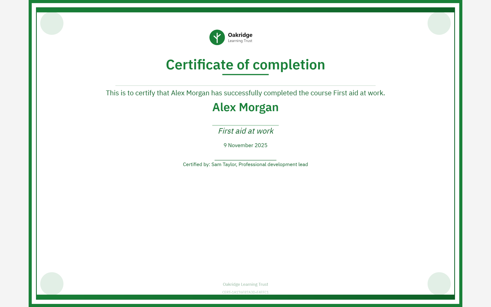

# Print a certificate

1. Click Print

   In **Certificates**, click **Print** (the printer icon) on the certificate's card. On a certificate page, click
   **Print** at the top.

2. Use the print dialog

   A new tab opens with the certificate and your browser's print dialog. Choose your printer and print, or choose
   **Save as PDF** as the destination to keep a PDF copy.

   

If nothing happens when you click **Print**, your browser has probably blocked the new tab. Allow pop-ups for GrowthXP and try
again.
