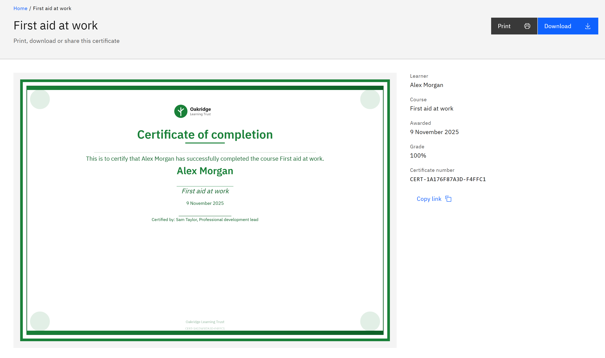

# Share a certificate link

Every certificate has its own page with a permanent address, so you can point your manager or HR to it.

1. Open the certificate page

   In **Certificates**, click the certificate's title or **Open certificate page**. The page shows the certificate and
   its details: **Learner**, **Course** or **Learning pathway**, **Awarded**, **Grade** and **Certificate number**.

   

2. Copy the link

   Click **Copy link**. A message confirms **Link copied**. If your browser can't copy, the message shows the link so you
   can copy it yourself.

3. Send it

   Paste the link into an email or message to the person who needs it.

> **Note:** The link isn't public. The person must sign in to GrowthXP, and only you, your line managers and people with
> the **Organisation administrator**, **Course manager** or **HR manager** role can open it. Anyone else sees **Certificate not found**. To share with someone outside
> your organisation, send them the downloaded certificate instead.

The certificate email you receive links to this same page, and your HR record may link to it too.
