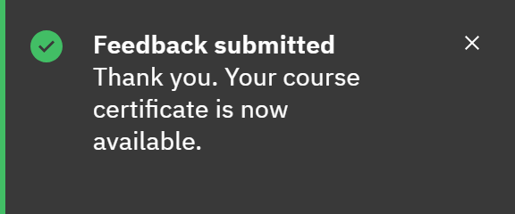

# How you earn a certificate

Nobody needs to approve your certificate: GrowthXP issues it as soon as you meet the course's conditions.

1. Check that the course awards one

   In the course details, **Certificate** and the message "Completing this course earns you a certificate." show that
   it does. Not every course awards a certificate.

2. Complete the course

   Finish the course. If it has a pass mark, your score must reach it. A course that just says you've passed counts.

3. Submit feedback if it's required

   If the feedback form says "Submit your feedback to receive your certificate.", the certificate waits for your
   feedback. Submit it, even if it's late, and the certificate is issued straight away.

   

4. Find it

   The certificate appears in **Certificates**, and you may get an email with a link to it.

For a learning pathway, you receive its certificate when you've completed every course in it, with any required feedback,
and met the pathway's average score if it has one. Each renewal of a course earns a new certificate. Completions recorded
in HR don't get a certificate in GrowthXP; complete the course in GrowthXP if you need one.
