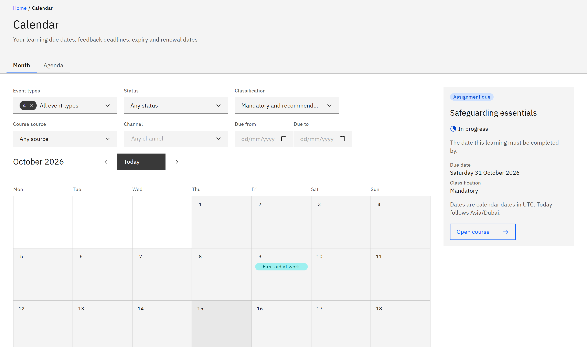

# See your learning deadlines

**Calendar** shows your learning deadlines in a month: when learning is due, when feedback is due, when completions
expire and when renewals start. It doesn't show sessions or events.

1. Open Calendar

   Click **Calendar** in the header. It opens on this month in the **Month** view.

2. Move between months

   Use **Previous month** and **Next month** (the arrows), or **Today** to come back to the current month.

3. Read the month

   Days with deadlines show how many there are and up to three coloured tags with course names. The colour and label
   show the type: **Assignment due**, **Feedback due**, **Expiry** or **Renewal due**.

   

4. Pick a day

   Click a day. Its deadlines are listed under the calendar, each with its type, course and status, such as **Overdue**,
   **Feedback pending** or **Expiring soon**.

5. Open a deadline

   Click a deadline. The **Deadline details** panel shows what the date means, the course's **Classification** and its
   **Learning cycle**.

6. Go to the course

   Click **Open course** to open the course's details in **My courses**.

Dates are calendar dates, the same in every time zone. Renewal dates appear for mandatory learning only. Learning given
to a whole group you belong to appears in **My courses** but may not appear here. You can also move around the calendar
with the keyboard: arrow keys move by day and week, Page Up and Page Down by month.
