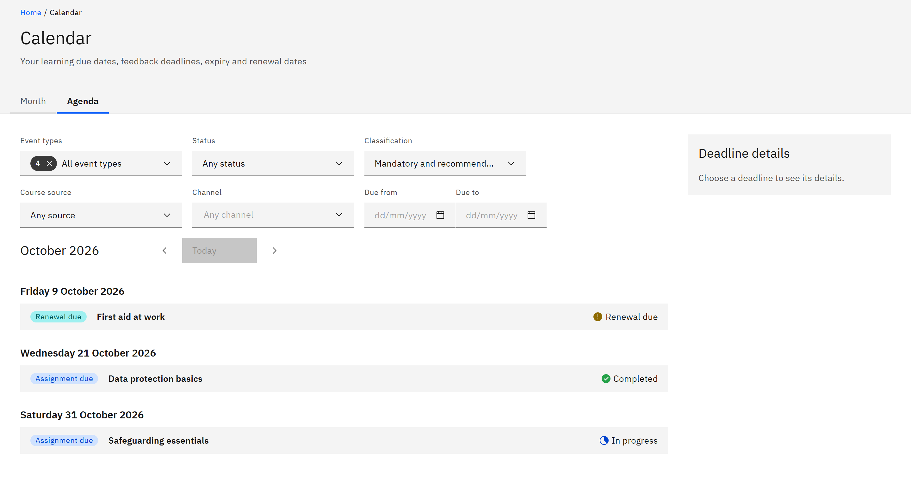

# Use the agenda view

The agenda lists the month's deadlines day by day, which is quicker to scan than the grid.

1. Switch to Agenda

   In **Calendar**, click the **Agenda** tab.

2. Read the list

   Each day that has deadlines is listed in date order, with today marked **(today)**. Under each day you'll see each
   deadline's type, course and status.

   

3. Open a deadline

   Click a deadline to see its **Deadline details**, then **Open course** to go to the course.

4. Change month

   Use **Previous month**, **Today** and **Next month** as in the month view.

If the month has nothing, you'll see **No deadlines in** and the month. Click **Month** to go back to the grid.
