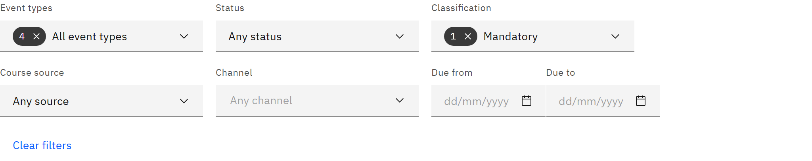

# Filter your calendar

Narrow the calendar to the deadlines you care about, for example only overdue mandatory learning.

1. Choose event types

   Open **Event types** and tick the types to show: **Assignment due**, **Feedback due**, **Expiry** and **Renewal due**.
   At least one must be ticked.

   

2. Choose statuses

   Open **Status** and tick, for example, **Assignment overdue** or **Expiry: expiring soon**. **Assignment upcoming**
   means not started or in progress.

3. Narrow by course

   Use **Classification** for **Mandatory** or **Recommended** learning, **Course source** for courses **Created in the
   LMS** or **From HR**, and **Channel** for courses in a channel such as **Compliance**.

4. Set a date range

   Pick a **Due from** and **Due to** date to see only deadlines between them. If the range is in another month, click
   **Go to** and the month.

5. Clear the filters

   Click **Clear filters** to show everything again.

The calendar updates as you choose. Your filters, month and view are kept in the page address, so you can bookmark a view
and open it again later.
