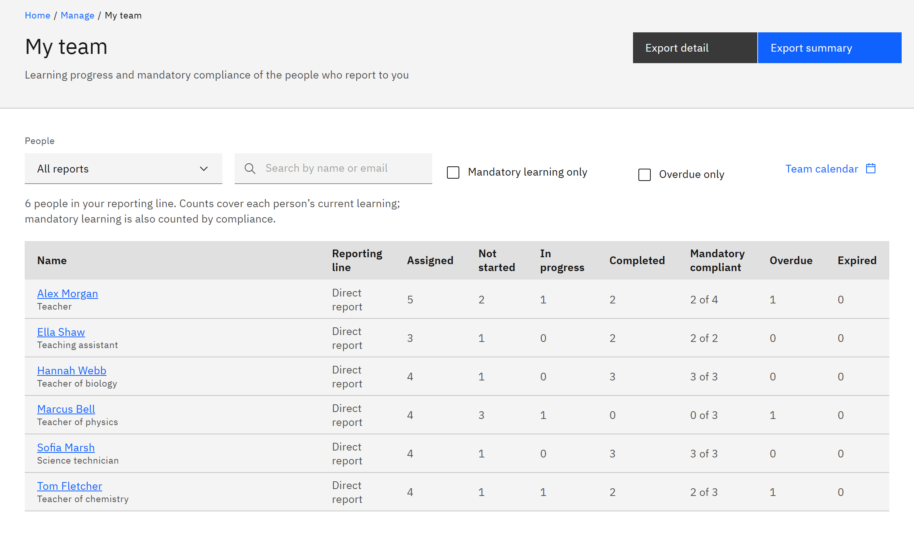

# View your team's learning

**My team** shows one row for each person in your reporting line, with counts of their learning and mandatory
compliance. It's for line managers: you have access when people report to you.

1. Open My team

   Click **Manage** in the header, then **My team** under **Organisation**. A line above the table says how many people
   are in view, for example "12 people in your reporting line".

2. Choose who to show

   Under **People**, choose **All reports** (the default) or **Direct reports only**. Type in **Search people** to find
   someone by name or email. Tick **Mandatory learning only** to count only mandatory learning, or **Overdue only** to
   list only people with overdue mandatory learning. Your choices stay in the page address, so you can bookmark the view.

   

3. Read the counts

   **Reporting line** shows **Direct report**, or who the person reports to. **Assigned**, **Not started**, **In
   progress** and **Completed** count the person's current learning. **Mandatory compliant** shows how many of their
   mandatory courses are up to date, for example "3 of 4". **Overdue** and **Expired** count mandatory learning only and
   are highlighted when they're above 0.

4. Open a person

   Click a name to see that person's courses, due dates and certificates. If the list is long, click **Show more** at
   the bottom to load more people.
