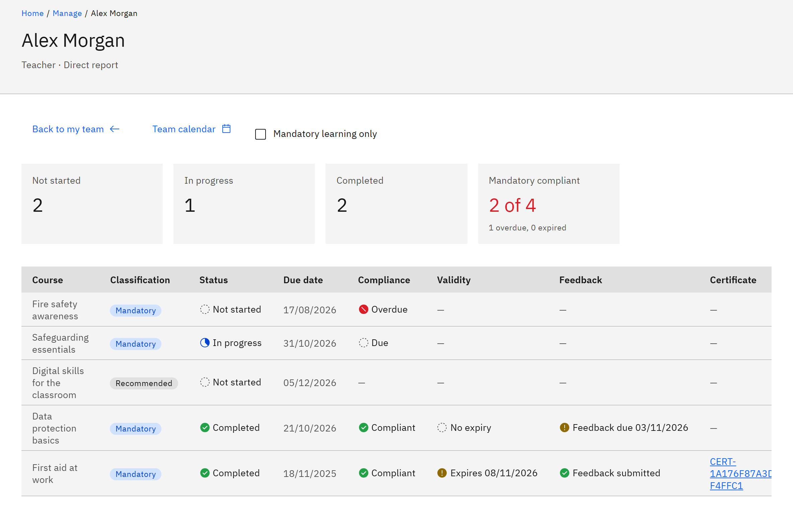
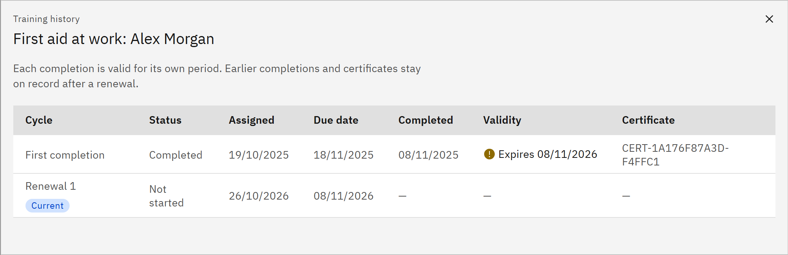

# View a team member's learning

A team member's page lists every course they have, how far they've got and whether their mandatory learning is up to
date. It's for line managers, and only for people in your reporting line.

1. Open the person

   In **Manage** ▸ **My team**, click the person's name. The page title is their name, with their job title and
   reporting line underneath.

2. Read the summary tiles

   The tiles count their **Not started**, **In progress** and **Completed** learning. **Mandatory compliant** shows how
   many mandatory courses are up to date, with how many are overdue or expired underneath. Tick **Mandatory learning
   only** to list only mandatory courses.

   

3. Read each course

   **Classification** is **Mandatory**, **Recommended**, or **Not assigned** for a course they started without being
   assigned it. **Status** is **Not started**, **In progress** or **Completed**. A **Recorded in HR** tag means the
   completion came from your HR system, with no certificate in GrowthXP. **Compliance** shows
   **Compliant**, **Due**, **Overdue** or **Expired** for mandatory learning. **Validity** shows when a completion
   expires. **Feedback** shows whether they've given course feedback, and when it's due. A renewed course shows
   "Cycle 2" (or later) under its title.

4. Open a certificate

   Click the number in the **Certificate** column to open the certificate page, where you can view, print or download
   it.

5. See the training history

   Click the **Training history** icon at the end of a row. The window lists every cycle of that course: when it was
   assigned, when it was due and completed, its validity and its certificate. Earlier completions and certificates stay
   on record after a renewal.

   

6. Go back

   Click **Back to my team** to return to the list, or **Team calendar** to see your team's deadlines.
