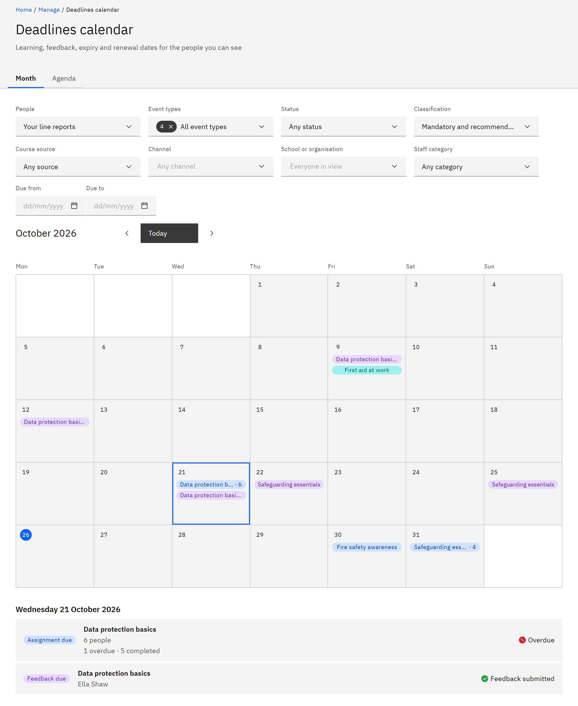

# See your team's deadlines

The deadlines calendar shows when your team's learning is due, when course feedback is due, and when completions
expire or need renewing. It's for line managers; other roles use the same calendar for wider groups of people.

1. Open the calendar for your team

   In **Manage** ▸ **My team**, click **Team calendar**. You can also click **Deadlines calendar** in the side
   navigation. **People** shows **Your line reports**. If you also hold an organisation or HR role, choose **Your line
   reports** under **People** to see only your team.

2. Pick a month and a view

   Use **Previous month**, **Today** and **Next month** to move around. **Month** shows a grid with the selected day's
   deadlines listed underneath. **Agenda** lists every day in the month that has deadlines.

   

3. See who's due

   Each course appears once a day for each type of deadline, with a summary such as "1 overdue · 3 in progress". Click it
   to open the panel on the right, which counts the people in each state and lists them, most urgent first. Click a
   person to see their deadline, then **Back to all people**.

4. Narrow the deadlines

   Use the filters at the top, such as **Event types**, **Status** and **Classification**, to focus on what matters. See
   [Filter the deadlines calendar](../07-People-and-assignments/16-filter-the-deadlines-calendar.md) for every filter.
