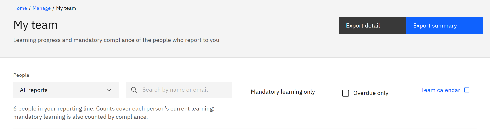

# Export your team's learning

You can download your team's learning as a CSV file to open in Excel. It's for line managers, and covers only the
people in your reporting line.

1. Filter the list

   In **Manage** ▸ **My team**, set **People**, **Search people**, **Mandatory learning only** and **Overdue only** to
   match what you need. The export uses exactly the people and learning on screen.

2. Choose the export

   Click **Export summary** for one row per person, with their counts and mandatory compliance. Click **Export detail**
   for one row per person and course, with the status, due date, compliance, completion date and source, expiry,
   validity, feedback and certificate number.

   

3. Open the file

   The file downloads as `my-team-summary.csv` or `my-team-detail.csv`. If you see **Export failed**, try again.
