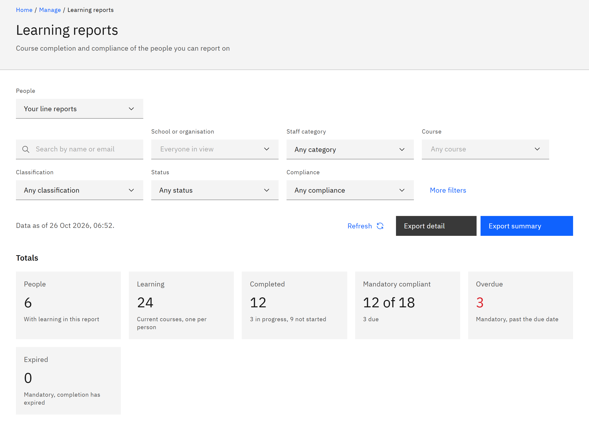

# Report on your team

**Learning reports** gives totals and a detailed list of your team's learning, with more filters than **My team**. It's
for line managers, and covers only the people in your reporting line.

1. Open Learning reports

   Click **Manage** in the header, then **Learning reports** under **Organisation**. If you also hold an organisation or
   HR role, choose **Your line reports** under **People**.

2. Read the totals

   The **Totals** tiles count the **People**, their **Learning**, how much is **Completed**, how much mandatory
   learning is compliant, and what's **Overdue** or **Expired**. Under **Totals by**, choose **Course**, **School** or
   **Staff category** to break the numbers down.

   

3. Narrow the report

   Use **Search people** and the filters, such as **Course**, **Classification**, **Status** and **Compliance**. Click
   **More filters** for validity, feedback and date ranges. See
   [Filter a learning report](../08-Reports/02-filter-a-learning-report.md).

4. Export it

   Click **Export summary** or **Export detail**. As a line manager you can export your team's report. See
   [Export a learning report](../08-Reports/04-export-a-learning-report.md).
