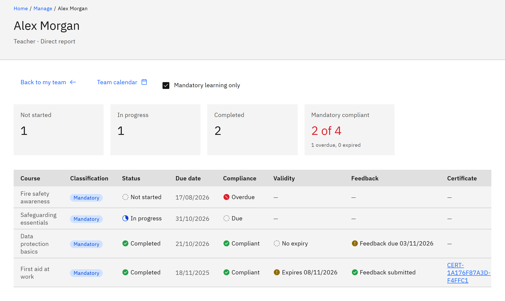

# Respond to an overdue learning email

If your organisation has turned on manager escalation, GrowthXP emails you when someone in your team
still hasn't completed their overdue mandatory learning. It's for line managers. Manager escalation is off unless an
organisation administrator turns it on.

1. Know why you got the email

   The person has mandatory learning that's past its due date, and they've already been sent a set number of overdue
   reminders (two, unless your organisation chose a different number). You're emailed at the next daily check, once
   for that course. By default the subject is "Overdue learning:" followed by the person's name and the course, and the
   email says how many days overdue it is and how many reminders they've had. Your organisation can change the wording.

2. Open their learning

   Click **View their learning** in the email. It opens the person's page in **My team**, where you can check the
   course's due date, status and history.

   

3. Follow it up

   Talk to the person about completing the course. You can't change their due date or remove the course yourself. If
   the due date should change, ask an HR manager or organisation administrator.

4. Know when it stops

   You won't be emailed again about the same overdue course. An email that hasn't been sent yet is cancelled if the
   person completes the course, the course is removed or renewed, the due date changes, or they leave. Recommended
   learning is never overdue, so it never sends these emails. You're only emailed while you're the person's current
   line manager.
