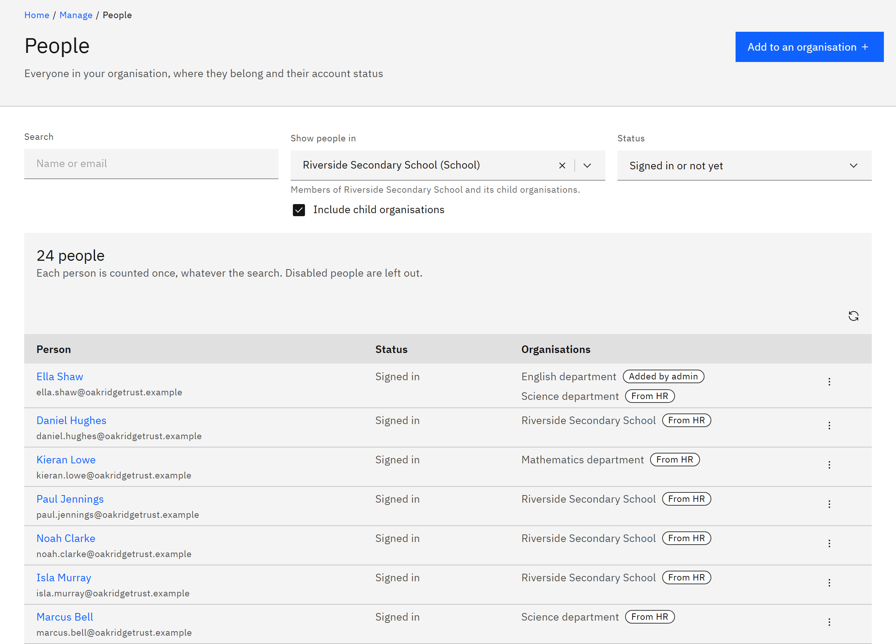

# Find a person

The **People** page lists everyone in the organisations you can see: where they belong and whether they've signed in.
You need the **Learning manager** or **Organisation administrator** role.

1. Open People

   Click **Manage** in the header, then **People** under **Organisation**. The table title shows how many people are in
   view, for example "248 people".

2. Choose the organisation

   Under **Show people in**, choose an organisation. Learning managers see the organisations they're responsible for.
   **Include child organisations** is ticked where you can see them, so choosing a trust or region also shows its
   schools. The line under the field says exactly who's included, for example "Members of Riverside Secondary School and
   its child organisations."

   

3. Search and filter

   Type a name or email in **Search**. Under **Status**, the default **Signed in or not yet** shows everyone who can use
   GrowthXP. Choose **Signed in**, **Not signed in yet** (imported from HR and waiting for their first
   sign-in), **Disabled**, or **All, including disabled**.

4. Read the list

   Each row shows the person's name and email, their **Status**, and the **Organisations** they currently belong to.
   **From HR** means the membership comes from your HR system; **Added by admin** means someone added it in Growth
   Experience Platform. Hover over **Disabled** to see why the account was disabled.

5. Open their details

   Click the person's name, or click the row menu and choose **View details**. Click **Refresh list** to reload the
   page after changes made elsewhere.
