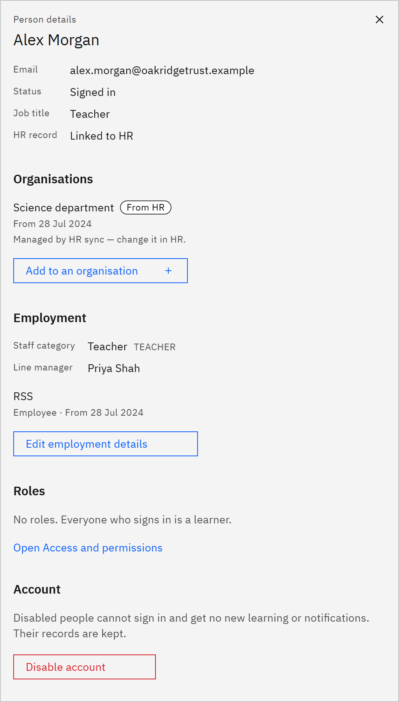

# View a person's details

A person's details show who they are, every organisation they belong to or belonged to, and the roles they hold. You
need the **Learning manager** or **Organisation administrator** role.

1. Open the details

   In **Manage** ▸ **People**, click the person's name. **Person details** opens on the right.

2. Check who they are

   The top of the panel shows their **Email**, **Status**, **Job title** and **HR record** (**Linked to HR** or **Not
   linked to HR**). For a disabled account, **Reason** says why and since when.

   

3. Check their organisations

   **Organisations** lists the organisations they belong to now, with dates and where each membership came from.
   **Starting later** lists memberships that haven't started yet, and **Past** lists the ones that have ended. A
   membership from HR says "Managed by HR sync — change it in HR." Someone with no organisation belongs to the whole
   organisation.

4. Check their roles

   **Roles** lists any roles they hold, such as **Learning manager** for a school. **Line manager** shows as "Automatic,
   from the manager hierarchy". Everyone who signs in is a learner, so a person with no roles shows "No roles. Everyone
   who signs in is a learner."

5. Check employment and account

   If you can see the whole organisation, **Employment** shows their staff category, line manager and employments, and
   **Account** lets an administrator disable or re-enable the account. The **Access and permissions** section of this
   help covers those tasks.
