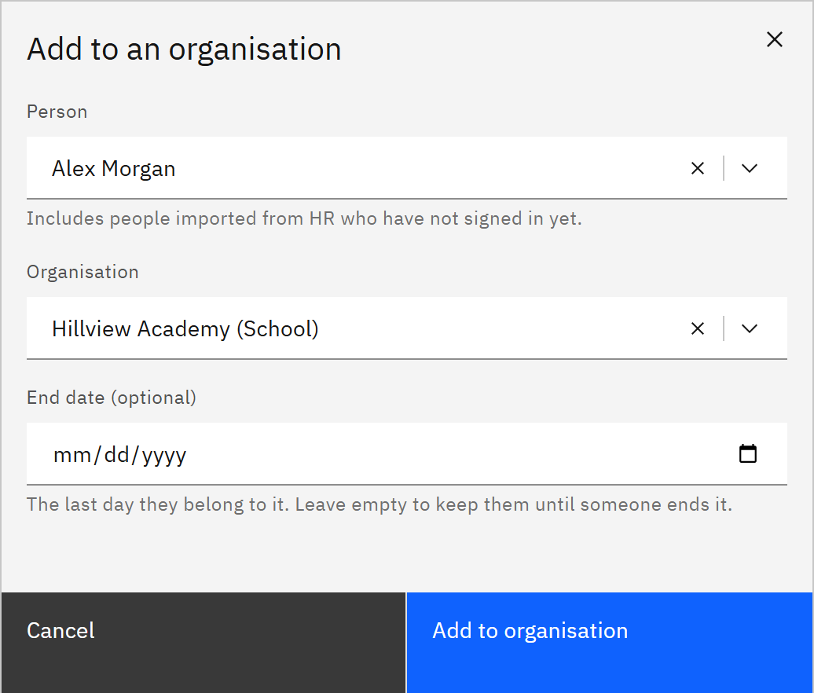

# Add someone to an organisation

You can add a person to a school, department or other organisation, for example someone who works across two schools.
You need the **Learning manager** or **Organisation administrator** role. Learning managers can add people to the
organisations they're responsible for.

1. Start adding

   In **Manage** ▸ **People**, click **Add to an organisation**. You can also choose **Add to an organisation** from a
   person's row menu or their details, which fills in the person for you.

2. Choose the person

   Under **Person**, search by name or email. You can add people who have signed in, and people imported from HR who
   haven't signed in yet. Adding someone to an organisation gives them no access by itself.

   

3. Choose the organisation and end date

   Under **Organisation**, choose where they belong. To make it temporary, enter an **End date (optional)**: the last
   day they belong to it. Leave it empty to keep them until someone ends it.

4. Add them

   Click **Add to organisation**. The membership starts straight away and shows **Added by admin** on the People list.
   Active learning rules check the person again, so they may be assigned learning for their new organisation. You can't
   add someone who's disabled, or who already belongs to that organisation for the same dates.
