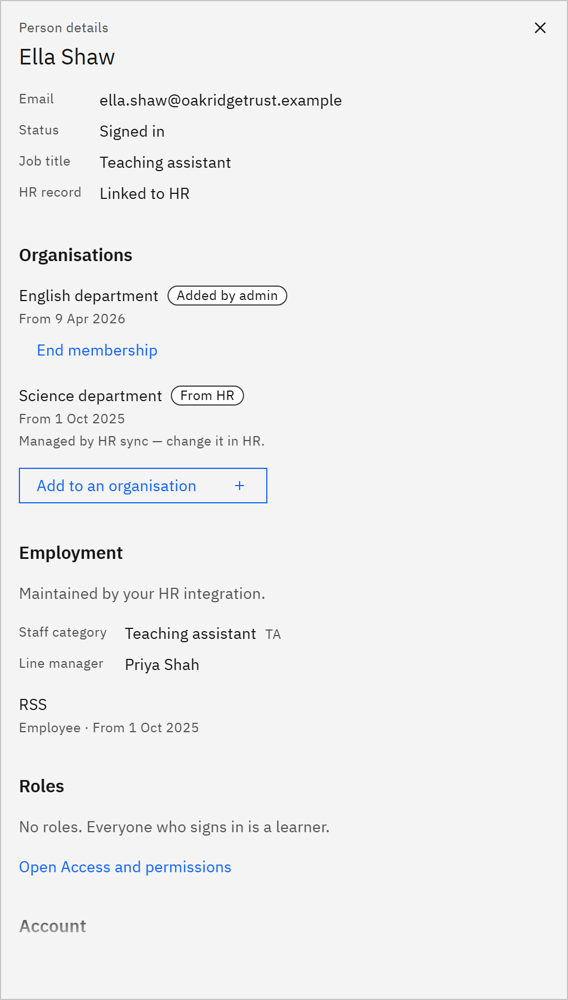

# End an organisation membership

You can end a membership that was added in GrowthXP. You need the **Learning manager** or
**Organisation administrator** role.

1. Open the person's details

   In **Manage** ▸ **People**, click the person's name.

2. End the membership

   Under **Organisations**, click **End membership** next to the organisation. Only memberships added in Growth
   Experience Platform have this button. Memberships from HR say "Managed by HR sync — change it in HR."

   

3. Confirm

   Click **End membership**. The person no longer belongs to that organisation, and it moves to **Past** in their
   details. Their learning records stay. If it was their last organisation, they belong to the whole organisation
   again. Active learning rules check the person again, so open mandatory learning that only applied to that
   organisation may be withdrawn.
