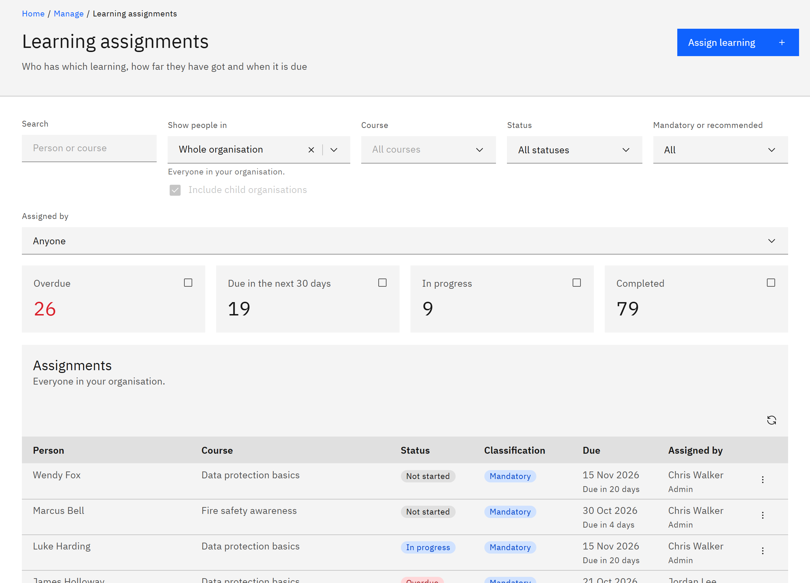

# View learning assignments

**Learning assignments** is one list of everyone's learning: who has which course, how far they've got and when it's
due. You need the **Learning manager**, **Report viewer**, **HR manager** or **Organisation administrator** role. Report
viewers can look but not change anything.

1. Open Learning assignments

   Click **Manage** in the header, then **Learning assignments** under **Organisation**.

2. Choose whose learning to see

   Under **Show people in**, choose an organisation. HR managers and organisation administrators start on **Whole
   organisation**; learning managers and report viewers start on the first organisation they're responsible for. Tick
   or clear **Include child organisations** to include or leave out the schools and departments below it.

   

3. Filter the list

   Type a person or course in **Search**. Choose a **Course**, a **Status** (**Not started**, **In progress**,
   **Overdue**, **Due in the next 30 days** or **Completed**), **Mandatory or recommended** (**Mandatory**,
   **Recommended** or **Not set**) and **Assigned by** (**Learning rule**, **Admin**, **Bulk assignment**, **HR** or
   **Self-enrolled**). Changing the organisation clears the course filter.

4. Read each row

   **Person** links to the person's details; a **Group** tag means a group assignment. **Course** shows "Renewal 1", "Renewal 2"
   and so on under renewed learning. **Status** is a coloured tag, with **Recorded in HR** when the completion came
   from your HR system. **Classification** shows **Mandatory**, **Recommended** or "Not set". **Due** shows the date and
   a note such as "Due in 5 days", "Due today" or "Overdue". Recommended learning past its date shows "Due date passed"
   because it's never overdue. **Assigned by** shows who or what assigned it.

5. Act on a row

   Click the row menu to **View details**. HR managers and organisation administrators also see **Change due date**.
   **Remove** appears for people who can remove assignments. Click **Refresh list** to reload.
