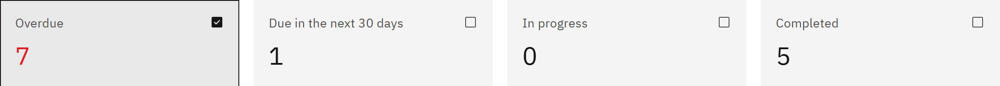

# Filter assignments with the summary

The summary above **Learning assignments** gives exact counts for the learning in view, and each tile works as a
filter. You need the **Learning manager**, **Report viewer**, **HR manager** or **Organisation administrator** role.

1. Read the counts

   The tiles count **Overdue**, **Due in the next 30 days**, **In progress** and **Completed** learning for the
   organisation and filters you've chosen. **Overdue** is highlighted when it's above 0. Learning due in the next 30 days
   is also counted as not started or in progress; overdue learning is counted only as overdue.

   

2. Filter by a tile

   Click a tile to show only that status in the list. The **Status** filter changes to match. Click the same tile
   again to show every status.

3. Choose a smaller organisation if the counts don't show

   For very large organisations the tiles show a dash and a message that counts are shown only up to a number of
   people. Choose a smaller organisation under **Show people in** to see them. The list below is always current.
