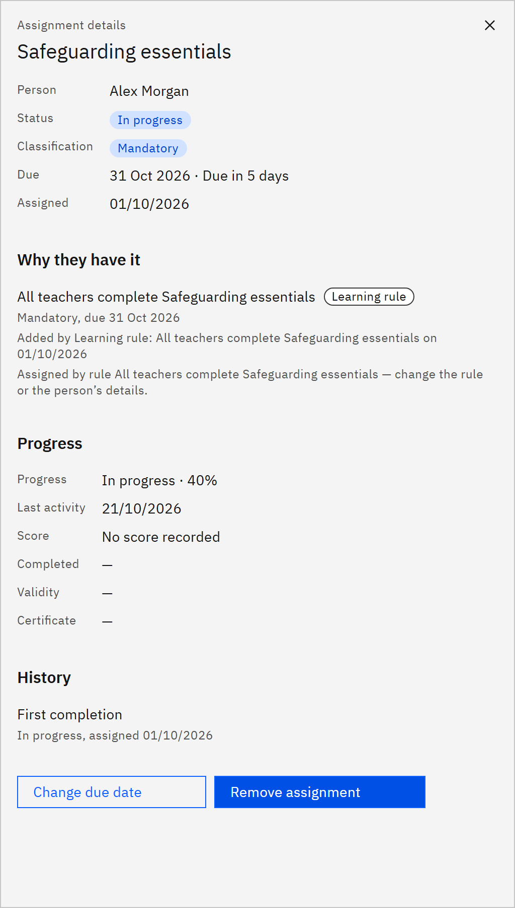

# View assignment details

An assignment's details show why the person has the course, how far they've got, and every cycle of it. You need the
**Learning manager**, **Report viewer**, **HR manager** or **Organisation administrator** role.

1. Open the details

   In **Manage** ▸ **Learning assignments**, click the row menu and choose **View details**. **Assignment details**
   opens on the right with the course name as the title.

2. Read the summary

   The top shows the **Person**, **Status**, **Classification**, **Due** date and when it was **Assigned**. A renewal
   shows its **Cycle**.

3. See why they have it

   **Why they have it** lists each source: a learning rule, an administrator, a bulk assignment, HR or self-enrolment,
   with its classification, due date and who added it. When several sources require the course, it's mandatory if any
   of them says so and due by the earliest mandatory due date.

   

4. Check their progress

   **Progress** shows the status and percentage, **Last activity**, **Score**, **Completed** date, **Validity**,
   **Certificate** number and **Feedback**.

5. Check the history

   **History** lists every cycle of the course, with its status and dates. The current cycle has a **Current** tag.

6. Change or remove it

   Use **Change due date** or **Remove assignment** at the bottom, if your role allows. These open their own window and
   close the details.
