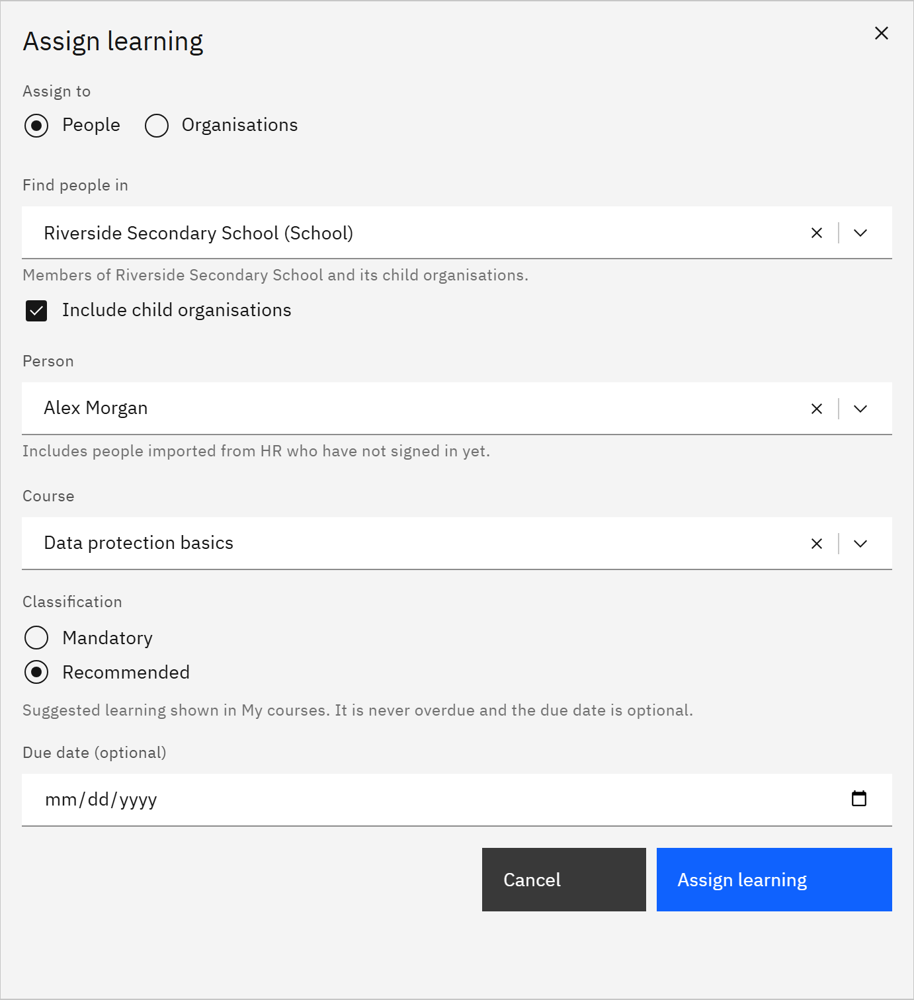

# Assign learning to people

You can assign a course to one person at a time. You need the **Learning manager**, **HR manager** or **Organisation
administrator** role. Learning managers assign to people in the organisations they're responsible for; HR managers and
administrators can assign to anyone.

1. Open the form

   In **Manage** ▸ **Learning assignments**, click **Assign learning**. If you see **Assign to**, choose **People**.

2. Choose where to find the person

   If you assign in more than one organisation, choose one under **Find people in**, and tick **Include child
   organisations** to include the schools or departments below it. HR managers and administrators can choose **Whole
   organisation**.

3. Choose the person and course

   Under **Person**, search by name or email. You can assign to people imported from HR who haven't signed in yet.
   Under **Course**, choose a published course. GrowthXP checks that the person can see the course;
   if not, **This person cannot access the course** explains why. An assignment never overrides a course's audience.

   

4. Choose mandatory or recommended

   Under **Classification**, your organisation's default is preselected. **Mandatory** counts towards compliance and
   becomes overdue after its due date. **Recommended** is never overdue.

5. Set a due date and assign

   Enter a **Due date (optional)** and click **Assign learning**. If the person already has the course, nothing changes,
   unless you chose **Mandatory** for a course they had as recommended: then it becomes mandatory for them, and the
   message says so.
