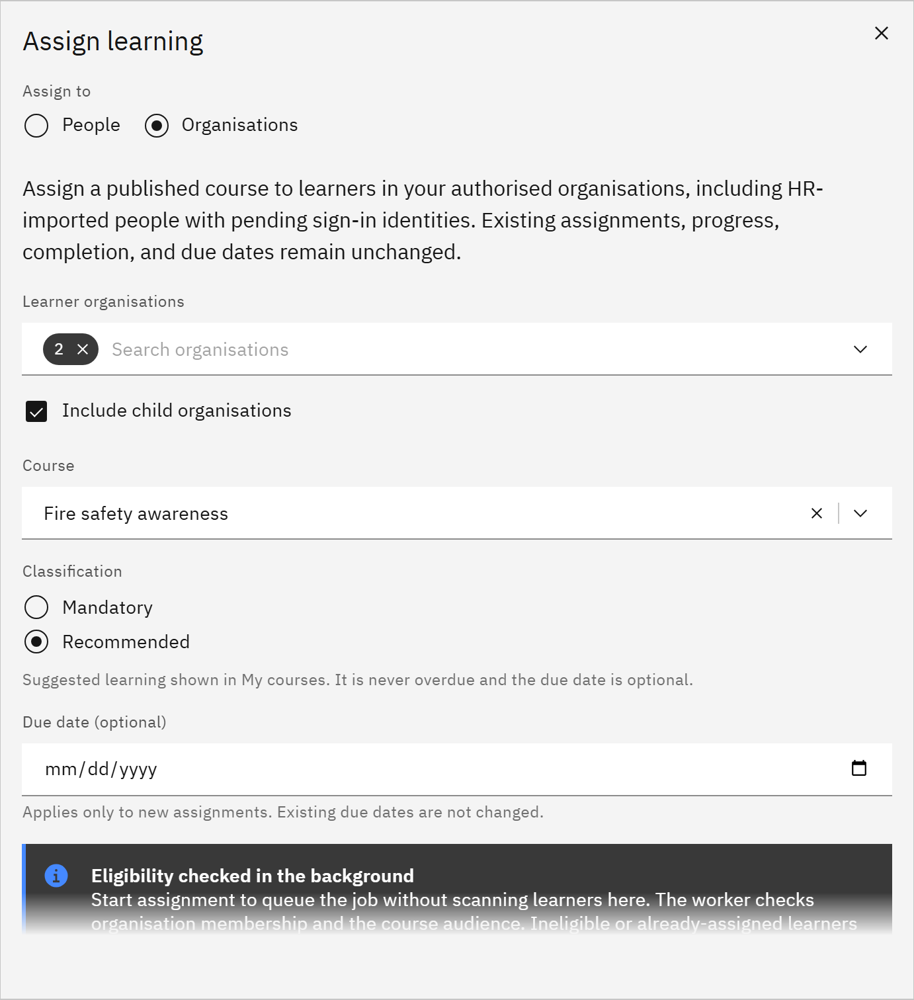

# Assign learning to organisations

Bulk assignment gives a course to everyone in one or more organisations at once. You need the **Learning manager** or
**Organisation administrator** role. Bulk assignment is off unless TMRW support has turned it on for your organisation;
until then the form says **Bulk assignments unavailable**.

1. Open the form

   In **Manage** ▸ **Learning assignments**, click **Assign learning**, then choose **Assign to** ▸ **Organisations**.

2. Choose the organisations and course

   Under **Learner organisations**, choose one or more organisations. Tick **Include child organisations** to include
   the schools or departments below them. Under **Course**, choose a published course.

   

3. Choose mandatory or recommended, and a due date

   Choose **Mandatory** or **Recommended** under **Classification**. A **Due date (optional)** applies only to new
   assignments: people who already have the course keep their due date, progress and completion.

4. Start the assignment

   Click **Start assignment**. Growth Experience Platform finds the people in the background, then assigns the course.
   It checks each person's organisation and the course audience, and skips anyone who isn't eligible or already has the
   course. You can close the window and check back later.

5. Check the results

   The window shows **Scan progress**, **Recipients found** and **Assignment progress**, then **Learner results** with
   each person's **Result**, an **Explanation** and **What you can do**. Assignments made this way stay in Growth
   Experience Platform and aren't sent to your HR system.
