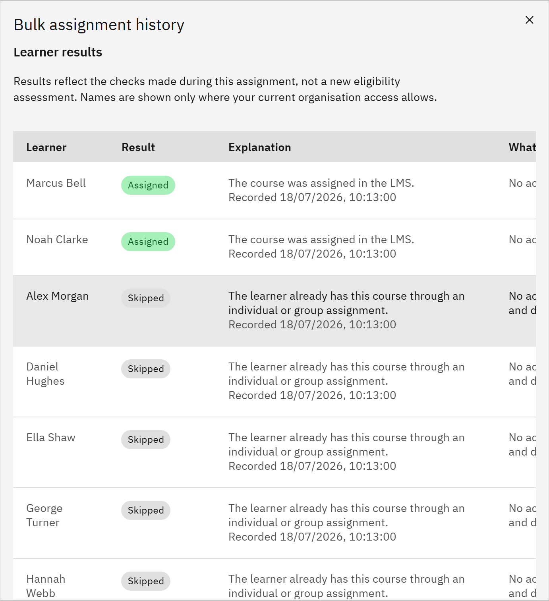

# Check bulk assignment history

You can look back at bulk assignments and see who was assigned or skipped. You need the **Learning manager** or
**Organisation administrator** role. Learning managers see the jobs they started.

1. Open the history

   In **Manage** ▸ **Learning assignments**, click **Bulk assignment history**.

2. Choose a job

   Under **Assignment history**, choose a job. Each one shows the course, when it was requested and its status.

   

3. Read the results

   The progress bars show how many people were found and processed: how many were assigned, skipped and failed.
   **Learner results** lists each person with their **Result** (**Assigned**, **Skipped**, **Not recorded**, **Not
   processed** or **Pending**), an **Explanation**, and **What you can do**. For example, someone who already had the
   course is skipped and needs nothing more.

4. Close it

   Click **Close**. If you need help from support, open **Support reference** to find the job's reference.
