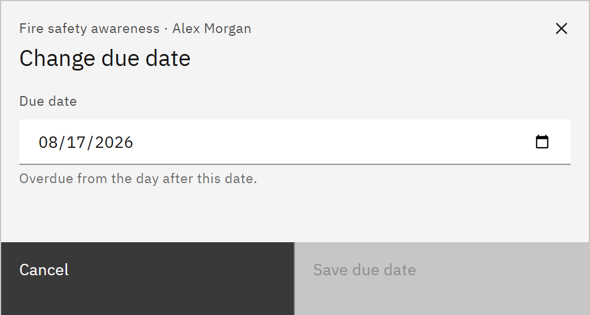

# Change a due date

You can give someone more time, or bring a deadline forward. You need the **HR manager** or **Organisation
administrator** role.

1. Open Change due date

   In **Manage** ▸ **Learning assignments**, find the assignment, open the row menu and choose **Change due date**. You
   can also click **Change due date** in the assignment's details. Completed learning has no due date to change.

2. Pick the date

   Choose the new **Due date**. Mandatory learning becomes overdue from the day after this date. Recommended learning is
   never overdue.

   

3. Save it

   Click **Save due date**. A message confirms the new date. Reminders follow the new date, and an overdue escalation
   email that hasn't been sent yet is cancelled.
