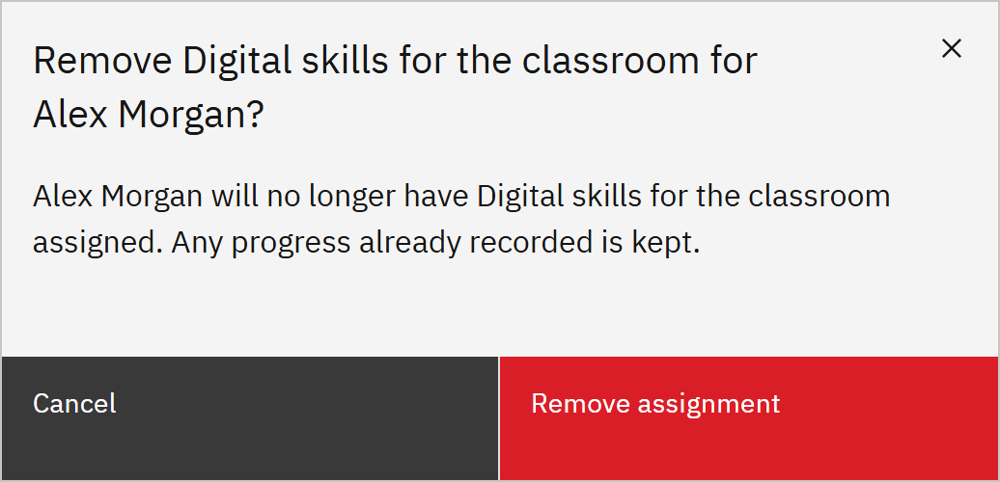

# Remove an assignment

You can withdraw learning that was assigned in GrowthXP. You need the **Learning manager**, **HR
manager** or **Organisation administrator** role. Learning managers can remove learning for people in the organisations
they're responsible for.

1. Choose Remove

   In **Manage** ▸ **Learning assignments**, open the row menu and choose **Remove**. You can also click **Remove
   assignment** in the assignment's details.

2. Check whether it can be removed here

   You can remove learning that an administrator or manager assigned, one by one or in bulk, and learning someone
   enrolled in themselves. Learning from HR shows "Managed by HR — cancel the registration in HR". Learning from a
   rule shows "Assigned by rule" and the rule's name, because the rule would assign it again: change the rule or the
   person's details instead.

   

3. Confirm

   Read the message, then click **Remove assignment**. Any progress, completion and certificate stay on record. If
   other sources also require the course, such as a learning rule, only what was assigned in GrowthXP
   is removed and the person keeps the course; the dialog says **Stays assigned** when this will happen.
